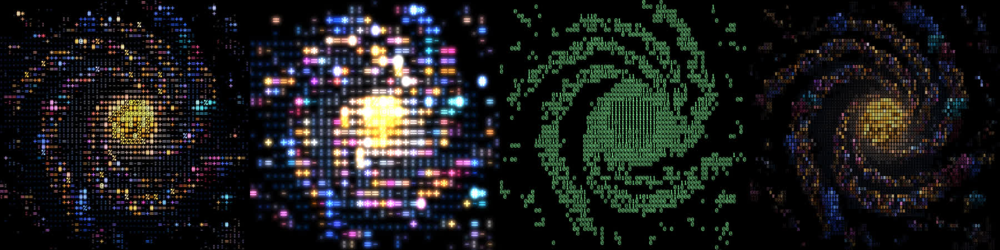
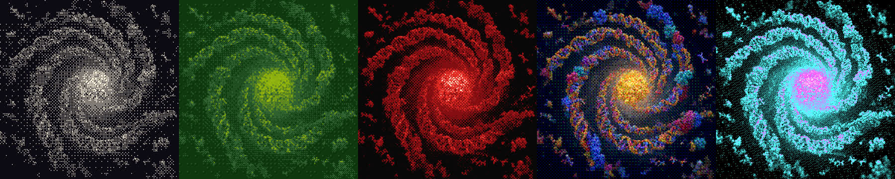

# ASCII and Dither effects (ISF)

Two live **effects** (they process whatever is playing under them, unlike the Optics Bench generators). Drop them on any clip, layer or the whole composition.

## ASCII.fs

Turns the picture into a grid of text characters, drawn from a built-in 5×7 pixel font, so there's nothing extra to install.

| Knob | What it does |
|---|---|
| **Size** | Character width in pixels (4–64). Small = fine text texture, big = chunky readable glyphs. |
| **Glow** | Soft bloom around every character (0 = off, 3 = heavy). The halo takes each character's own color. |
| Characters | Classic ` .:-=+*#%@`, Minimal ` .+#@`, Binary `0 1`, or Blocks (shade patterns). |
| Color | Source colors, Tint (mono, uses *Tint color*), or Source × Tint. |
| Tint color | Green phosphor by default. Try amber or ice blue. |
| Background | Color behind the characters. |
| Source behind | Mixes a dimmed copy of the picture behind the text. |
| Contrast / Brightness | How brightness maps to character density. Raise Brightness for dark footage. |
| Invert | Dark areas get the dense characters instead. |
| Scramble | Characters flicker and swap over time. Nice on breakdowns. |

## Dither.fs

Pixelates the picture and reduces it to a few colors with a dither pattern.

| Knob | What it does |
|---|---|
| **Size** | Pixel size (1–24). |
| Pattern | Bayer 2×2 / 4×4 / 8×8 (classic ordered dither), White noise, Blue-ish noise (smoother grain), Halftone dots, Lines. |
| Palette | Source colors, Duotone (uses *Dark* and *Light*), Game Boy, CGA, Ladybug (black, reds, cream). |
| Levels | Steps per channel for Source colors and Duotone (2 = pure 1-bit). The fixed palettes always use their 4 colors. |
| Dark / Light | The two duotone colors. |
| Dither strength | 0 = hard posterize, 1 = normal, 1.5 = extra grainy. |
| Contrast / Brightness | Push the image before it's reduced. |
| Halftone/line angle | Rotates the halftone and line screens. |
| Shimmer | Animates the pattern so the grain crawls. |

## Getting them into Resolume

**With Wire (recommended):**
1. In Wire, make a new patch and save it as an **Effect**. An effect patch has an input texture (the clip it's applied to) and an output.
2. Add an **ISF** node and point its **Fragment Shader** at `ASCII.fs` or `Dither.fs`.
3. Connect the patch's input texture to the node's `inputImage`, and the node's output to the patch output.
4. Expose the knobs you want (at least Size and Glow), then save.
5. In Arena/Avenue the patch shows up under **Effects**. Drag it onto a clip or layer.

**Without Wire:** VDMX and Magic Music Visuals load these `.fs` files directly as effects. Send their output into Resolume with Syphon (Mac) or Spout (Windows). Some Arena versions also pick up ISF files placed in `Documents/Resolume Arena/Extra Effects` (restart Arena, then check under Effects).

## Live tips

- **Map Size to a fader**, then sweep from 64 down to 6 over a build: the image resolves out of the text.
- **Link Glow to the kick** (audio analysis in Resolume, 0.5–2.5 range) so the characters pulse.
- **Dither on a round screen:** Bayer 8×8 at Size 3–4 reads best from a distance. Halftone looks great above Size 2.
- Stack them: Dither (Size 2, Duotone) feeding ASCII (Tint, Glow 1.5) gives a nice CRT-terminal look.

## Performance

Dither is very light. ASCII with Glow above 0 does a lot of work per pixel; it's fine on a dedicated GPU at 1080×1080. On a laptop GPU, run the layer at 720×720, or set Glow to 0 and use Resolume's own Bloom effect after it.

`tools/isf_fx_test.js` compiles both effects in a headless browser and renders the preview images.
